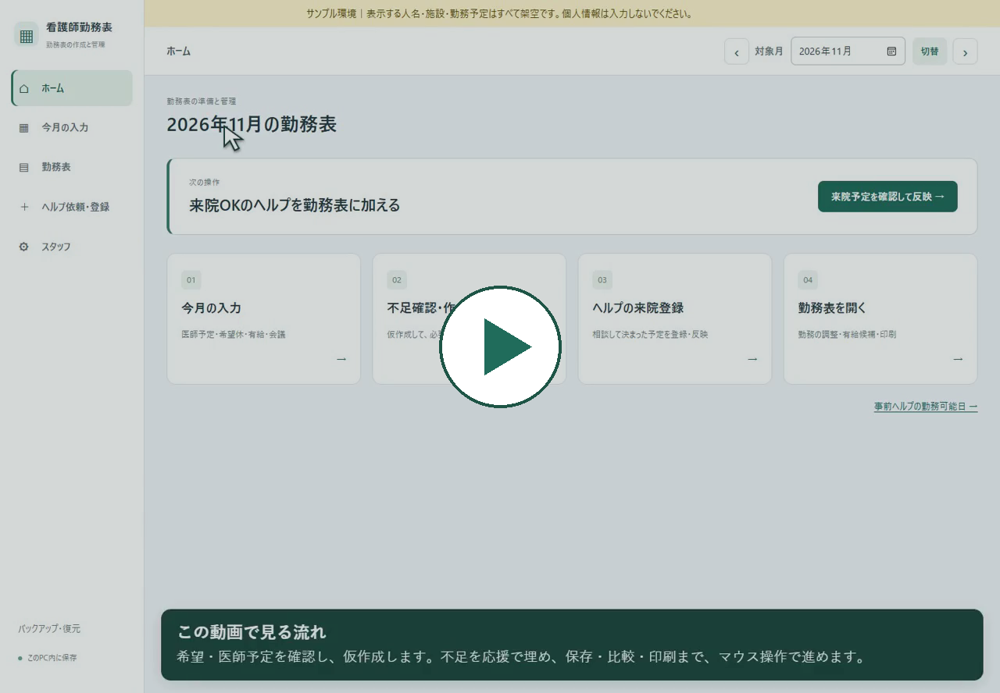

# 看護職員の勤務表作成支援アプリ

[](https://github.com/higakota/nurse-scheduler-demo/actions/workflows/tests.yml)

勤務希望・会議・必要人数・他施設からの応援をまとめて扱い、勤務表の作成後も変更内容を確認しながら調整できるWebアプリです。勤務表を作成する利用者からの相談・操作の感想をもとに、機能と画面を繰り返し改善しています。

[開発履歴](docs/development-history.md) · [不具合と改善の事例](docs/case-studies.md) · [設計](docs/portfolio.md) · [テストと確認方法](docs/verification.md) · **[サンプルExcel](samples/sample_requests_2026-11.xlsx)**

**[約5分27秒の操作動画を見る](https://higakota.github.io/nurse-scheduler-demo/)** ／ [動画の説明](docs/demo/README.md)

[](https://higakota.github.io/nurse-scheduler-demo/)

初回は **スタッフ → ホーム → ①今月の入力（医師予定から）→ ②不足を確認 → ③ヘルプを依頼・登録 → ④勤務表・印刷** の順に進みます。動画の再生速度はプレイヤー下で変更できます。

[ホーム画面](docs/screenshots/home.png) ／ [勤務と希望の比較](docs/screenshots/roster.png) ／ [印刷用表示](docs/screenshots/print.png)

| 項目 | 内容 |
|---|---|
| 技術 | Python / Flask / SQLite / HTML / CSS / JavaScript |
| 元の開発記録 | 2026年10月16日〜22日の67コミットを匿名化して収録 |
| 動作検証 | 仮名・一時DBを使う502件の自動テスト |
| データ | 職員9人・医師予定・勤務希望を新規作成した架空データ |
| 実行環境 | ローカルPCのブラウザ。現在の確認環境はWindows / Python 3.13 |

**公開版はサンプル環境です。実在する職員・施設のデータは含みません。** 開発履歴は個人情報と非公開資料を除いて再構成したため、元のコミットIDとは異なります。方法は [履歴の扱い](docs/development-history.md#履歴の扱い) に記載しています。

## 解決したいこと

勤務表は、最初に自動作成できれば終わりではありません。有給の追加、応援の来院日の変更、本人了承による出勤などが入ると、人数・連勤・公休日数を再び確認する必要があります。

このアプリでは、**作成した後の変更を、今見ている表に正しく反映できること**を重視しました。

| 利用中に分かった課題 | 改善内容 | 確認できるもの |
|---|---|---|
| 編集後に古い勤務表が開く | 元の表の種類・版・入力条件を照合して遷移・保存 | [修正事例1](docs/case-studies.md#1-編集後に古い勤務表が開く) |
| 検査室の職種の数え方で看護師不足が誤表示される | 検査技師2人の組み合わせも配置・不足表示で扱う | [修正事例2](docs/case-studies.md#2-検査室の人数と職種を正しく数える) |
| 了承出勤後に連勤が増える | 連勤と公休日数を再検証し、依頼済み応援を維持して調整 | [修正事例3](docs/case-studies.md#3-了承出勤後の連勤を調整する) |
| 会議参加者を保存するたびに画面が戻る | カレンダー上で複数人を編集して一括保存 | [修正事例4](docs/case-studies.md#4-会議をまとめて入力する) |
| 応援を1行にまとめると画面では読みにくい | 画面は個人別、印刷は集約する形へ修正 | [修正事例5](docs/case-studies.md#5-見やすさの改善案を利用者の反応で見直す) |

## 開発の積み重ね

| 時期 | 取り組み |
|---|---|
| 10/16〜18 | 環境構築、要件の整理、スタッフ・月別入力 |
| 10/19〜20 | Excel取込、人数設定、前月勤務、作成・編集・応援管理 |
| 10/21 | 不足を残す仮表、応援固定、了承変更、連勤・職種の扱い、導線改善 |
| 10/22 | 表の版の整合性、一括入力、半日有給、印刷、バックアップ・起動 |
| 公開版の整備 | 架空データの分離、全テスト、開発履歴と改善事例の整理 |

各段階の変更は [67件の開発履歴一覧](docs/development-history.md) と [development-historyブランチ](https://github.com/higakota/nurse-scheduler-demo/commits/development-history/) から確認できます。現在のサンプル版は `main` ブランチです。

## サンプルExcelを試す

**[Excelをダウンロード](https://raw.githubusercontent.com/higakota/nurse-scheduler-demo/main/samples/sample_requests_2026-11.xlsx)** ／ [ファイルの場所](samples/sample_requests_2026-11.xlsx) ／ [使い方](samples/README.md)

2026年11月の医師予定と、職員9人の希望欄を含む架空の入力見本です。曜日・希望欄の色分けと固定見出しを付けています。Excelファイルだけでは、全機能のデータは設定されません。初回起動で作成する架空DBと組み合わせて試せます。

## 起動する

Python 3.13を利用します。Windows PowerShellで次を実行します。

```powershell
git clone https://github.com/higakota/nurse-scheduler-demo.git
cd nurse-scheduler-demo
py -3.13 -m venv .venv
.\.venv\Scripts\python.exe -m pip install -r requirements.txt
.\.venv\Scripts\python.exe demo_run.py
```

ブラウザで http://127.0.0.1:5001/?month=2026-11 を開きます。初回は架空データを自動作成します。変更は `instance/demo.sqlite3` に保存します。終了は起動した端末で Ctrl+C です。セットアップ後は `start_demo.bat` からも起動できます。

サンプルは短時間で操作を試せるよう、診療日を8日に絞った簡略例です。公休日数や休日設定も架空の条件に合わせており、実在する施設の勤務条件を表していません。

### 操作の流れ

1. 2026年11月のホームからスタッフ・希望休・会議を確認する。
2. 「事前登録のヘルプも使って仮作成」で勤務表と不足を確認する。
3. 来院予定を確認し、応援を反映した表の変更箇所を確認する。
4. 編集画面で希望との比較、勤務の修正、印刷プレビューを試す。
5. Excel取込は、サンプルファイルの「11月」シートを選び、確認画面で担当医・日付を見直して保存する。

## 説明と再現確認

- [コードを追って説明する3つの改善](docs/explain-the-code.md)
- [新規フォルダ・新規venvでの起動確認](docs/first-run-check.md)
- [GitHub ActionsでのWindowsテスト](https://github.com/higakota/nurse-scheduler-demo/actions/workflows/tests.yml)

## 検証と制限

```powershell
.\.venv\Scripts\python.exe -B -m unittest discover -s tests
```

テストには一時DBと仮名を使います。探索結果は独立した検証処理でも確認します。全入力での最適解や、実際の勤務表としての正しさを保証するものではありません。利用者による最終確認が必要です。[確認対象と限界](docs/verification.md) を参照してください。

生成AIを実装・調査・テスト作成に利用しています。開発記録には、利用者から確認した課題、変更した処理、検証方法を具体例として残しています。

ローカル操作用のサンプルで、認証・権限管理・公開サーバーの運用設定は含みません。個人情報は入力しないでください。ライセンスは未設定です。
