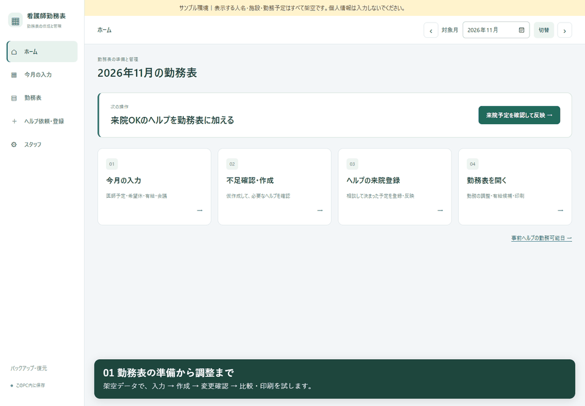

# 操作デモ

**[約80秒の操作動画（MP4・音声なし）](walkthrough.mp4)** ／ [ダウンロード](https://raw.githubusercontent.com/higakota/nurse-scheduler-demo/main/docs/demo/walkthrough.mp4)



GIFは実画面の静止画を抜粋して順番に表示したものです。MP4はブラウザでの実操作を記録した動画です。

## 動画の内容

1. ホームから職種・勤務条件・希望を確認する。
2. サンプルExcelを選択し、対象シートと読み取り結果を確認する。
3. 事前に来られる応援を使って仮作成し、検査技師の不足を確認する。
4. 来院予定を確認し、最新の入力・応援で勤務表を更新する。
5. 変更内容を確認して保存し、希望との比較と印刷用表示を見る。

サンプルの11月9日は、自院の検査技師2人に希望休を設定しています。仮表では検査技師が不足し、来院予定のある「応援スタッフ02」を反映すると埋まる例です。実際の施設の勤務条件ではありません。

Excelは読み取り結果の確認までを撮影しています。動画内でExcelの候補は保存せず、初期登録済みの架空予定を使って勤務表を作成しています。

[比較画面](../screenshots/roster.png) ／ [印刷用表示](../screenshots/print.png)

## 撮影と確認

- すべて架空データを使い、実用版とは別のDB・ポートで撮影。
- ブラウザの実操作を記録し、説明字幕を重ねた。
- 登録済みの応援が保存後の勤務表へ配置されたことを確認。
- 撮影中のJavaScript例外・サーバー500番台エラーは0件。
- 印刷部分はブラウザの印刷用CSSを表示した画面。OSの印刷ダイアログの映像ではない。
- [撮影確認記録](capture-report.json)に確認対象を記載。

## 再撮影する場合

通常のアプリ起動には撮影ライブラリは不要です。撮影用には別のvenvを作り、`tools/requirements-recording.txt` をインストールします。Microsoft Edgeを利用するWindows向けの補助スクリプトです。

```powershell
py -3.13 -m venv .capture-venv
.\.capture-venv\Scripts\python.exe -m pip install -r tools/requirements-recording.txt
.\.capture-venv\Scripts\python.exe -m playwright install ffmpeg
.\.capture-venv\Scripts\python.exe tools/record_walkthrough.py
```

先に別の端末で `python demo_run.py` を起動してください。撮影スクリプトはExcelの読取・勤務表の作成・反映・保存を行うため、変更してよい架空データのコピーで実行します。サンプル環境の表示と架空スタッフを確認できない場合は中止します。
