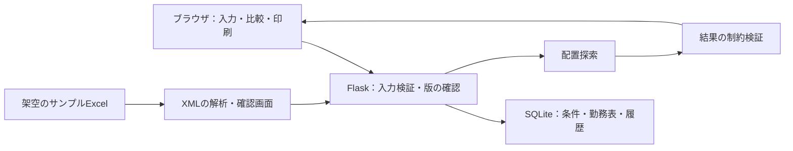

# 開発メモ

## 解決したい課題

勤務希望、会議、非常勤の上限、外部からの応援を別々に管理すると、変更のたびに人数や連勤の確認が必要になる。条件と保存済み勤務表を関連付け、作成後の修正も同じ導線で確認できるようにした。

## 構成

## 説明できる実装例

- 入力条件と勤務表の版を照合し、古い画面からの上書きを拒否する。
- 希望休・有給・会議・支援を半日単位で区別する。
- 依頼済み応援と事前に来られる応援を区別し、再作成時に扱いを分ける。
- 不足が残る場合も、足りない日・時間帯・職種を確認できる。
- 探索処理とは別に、完成結果の勤務条件を検証する。
- SQLiteのbackup APIで、利用開始時と最新保存状態をバックアップする。

## 制限と今後

全入力での最適解や実行時間の保証はしない。利用者の最終確認が必要。公開サーバー向けの認証・権限管理・監視は未実装。実用版の施設固有の入力資料や比較記録は公開対象から除外した。
