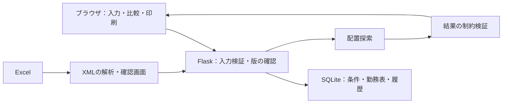

# 構成と設計判断

## 利用の前提と構成

実用側は、使用者のWindows PCで動かし、勤務データをPC内に保存する構成です。公開体験版は架空データで操作を試すための別環境です。

## 現在の構成が利用の前提に合う理由

| 技術・方針 | 目的と制約 |
|---|---|
| Python / Flask | 入力検証、配置探索、保存処理をPythonで扱い、画面はテンプレートで表示する |
| SQLite | PC内で保存でき、別途DBサーバーの導入を要求しない。バックアップはSQLiteのAPIを使う |
| HTML / CSS / JavaScript | カレンダーの入力・比較表示をブラウザ内で操作し、印刷用CSSで紙面を整える |
| XLSX内のXML解析 | 担当医・日付・書式など、必要な情報を取り出す。読み取り直後には確定せず、確認画面を経て保存する |
| 独立した結果検証 | 探索で見つかった配置について、人数・休み・連勤などの条件をもう一度確認する |
| Windows配布 | Pythonと依存ライブラリを内包し、使用者へ開発環境の準備を求めない |

## 表の状態と更新の整合性

入力条件、生成した表、編集して保存した表は役割が異なります。画面を開く際に元の表の種類・版・条件を照合し、表示対象と保存先を確かめます。確認画面を開いただけでは保存済みの表を更新しません。

- [roster_navigation.py](../roster_navigation.py)：元の表と版の扱い。
- [manual_schedule.py](../manual_schedule.py)：変更確認と保存。
- [test_roster_navigation.py](../tests/test_roster_navigation.py)：意図した表への遷移、古い画面の拒否。

## 業務上固定するものと調整するもの

事前に来られる応援と、追加依頼して来院が決まった応援を区別します。再作成・調整で依頼済みの時間帯を勝手に変えないようにし、不足する日・時間帯・職種を確認できるようにしています。

希望休・有給・会議・支援も半日単位で区別します。条件上の不足や連勤を、単なる合計人数だけで判断しません。

- [scheduler_engine.py](../scheduler_engine.py)：配置探索と結果検証。
- [help_commitments.py](../help_commitments.py)：依頼済みの条件の保持。
- [help_limits.py](../help_limits.py)：職種と応援の扱い。

## データを残す配布と保守

アプリ本体を版ごとのフォルダへ保存し、勤務データは共通の別フォルダに置きます。更新ファイルの構成とハッシュを確認し、起動確認、データのバックアップ、使用する版の切り替えを順に行います。前の版へ戻しても、更新後に入力した勤務データを自動で巻き戻しません。

[Windows配布の実装と確認](windows-install.md) ／ [バックアップ](../automatic_backup.py)

## 公開体験版と実用側の分離

| 環境 | データと目的 |
|---|---|
| 使用者のPC | PC内に入力とバックアップを保存。実データとセットアップ本体は非公開 |
| ローカルの公開サンプル | 架空データで初期化し、動作を再現する |
| Renderの公開体験版 | ブラウザごとに保存先を分離。一定時間後や再起動で初期化する |
| GitHub Pages | 操作動画と起動リンク。勤務データは保存しない |

[公開環境の構成](deployment.md) ／ [利用者別保存のテスト](../tests/test_web_demo.py)

## 制限

全入力での最適解や一定時間以内の探索完了を保証するものではありません。実務用サービスの認証・権限管理・監視は未実装です。施設固有の入力資料と実際の勤務表は公開せず、使用者の業務上の最終確認と、自動テストの結果を区別します。
