# 成果画像

架空データを使った実際のアプリ画面です。全11枚を1912×1036pxにそろえています。画面部分の切り出しや表示倍率を調整している画像があります。

## 画像一覧

| 番号 | 画面 | 見られること |
|---|---|---|
| 01 | [ホーム画面](screenshots/home.png) | 入力から勤務表までの手順と、次の操作を確認できます。 |
| 02 | [勤務表と希望の比較](screenshots/roster.png) | 実際の勤務と、希望休・有給を上下で比較できます。 |
| 03 | [印刷用勤務表](screenshots/print.png) | 希望欄と応援を整理した印刷用表示です。下書き・未確定のサンプルです。 |
| 04 | [希望休・有給の入力](screenshots/absence-input.png) | 全員の希望をカレンダーで見ながら入力し、まとめて保存できます。 |
| 05 | [会議の入力](screenshots/meetings.png) | 会議の日程と、スタッフごとの参加を入力する画面です。月の一部を表示しています。 |
| 06 | [不足の確認](screenshots/draft-shortage.png) | 事前ヘルプも使った仮表で、11月9日の午前・午後に検査技師が1人不足する例です。 |
| 07 | [ヘルプの来院登録](screenshots/help-calendar.png) | 不足と来院予定を同じカレンダーで確認します。11月9日の全日来院を選んだ保存前の状態です。 |
| 08 | [必要人数の設定](screenshots/coverage.png) | 医師予定に応じた必要人数と、検査室の人数を確認します。診療日の3日分を表示しています。 |
| 09 | [バックアップと復元](screenshots/backup.png) | 全月の入力を保存し、ファイルの内容を確認してから復元する画面です。 |
| 10 | [スタッフと担当業務](screenshots/staff.png) | 看護師・検査技師、常勤・非常勤、担当可能な業務を確認できます。 |
| 11 | [Excelの読み取り確認](screenshots/doctor-import.png) | Excelから取り出した午前・午後の医師予定を照合する画面です。確認前の候補を表示しています。 |

## 代表的な画面

### ホーム画面

入力から勤務表までの手順と、次の操作を確認できます。

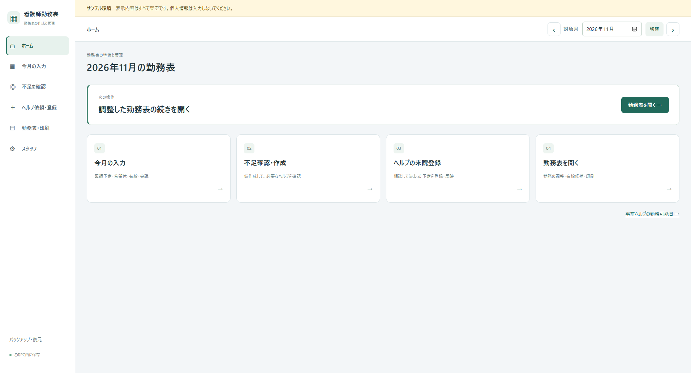

### 勤務表と希望の比較

実際の勤務と、希望休・有給を上下で比較できます。

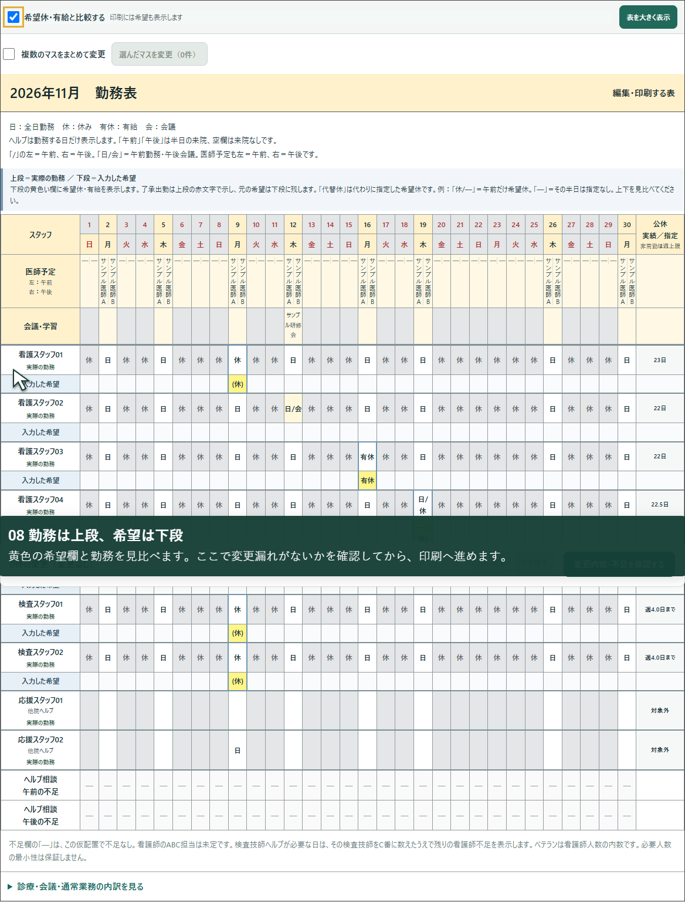

### 印刷用勤務表

希望欄と応援を整理した印刷用表示です。下書き・未確定のサンプルです。

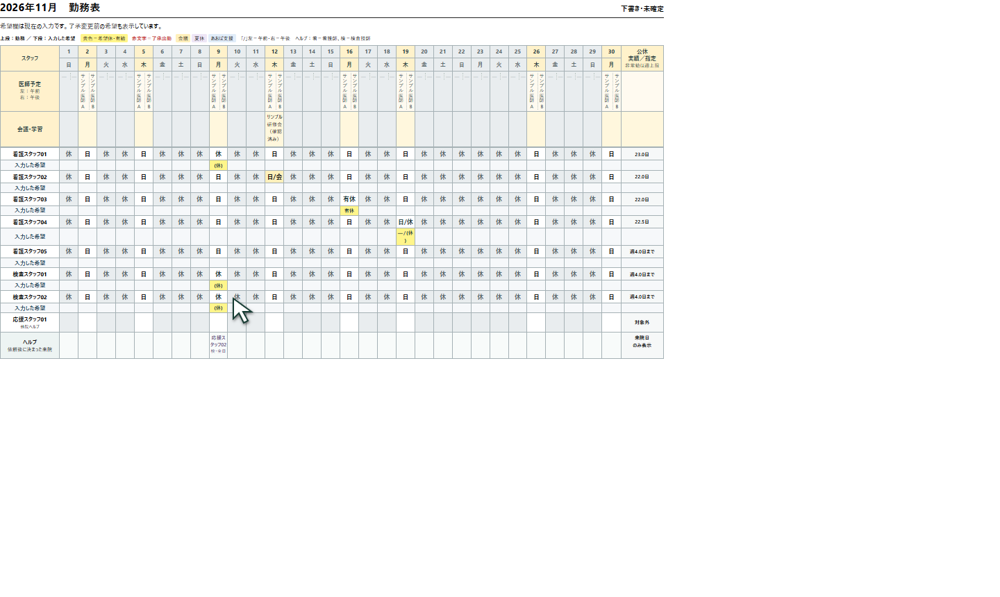

## 各機能の画面

項目を開くと画像を表示します。画像一覧のリンクからは直接開けます。

希望休・有給の入力

全員の希望をカレンダーで見ながら入力し、まとめて保存できます。

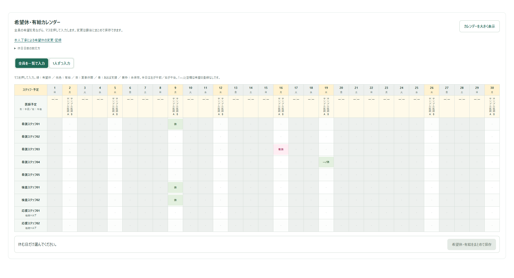

会議の入力

会議の日程と、スタッフごとの参加を入力する画面です。月の一部を表示しています。

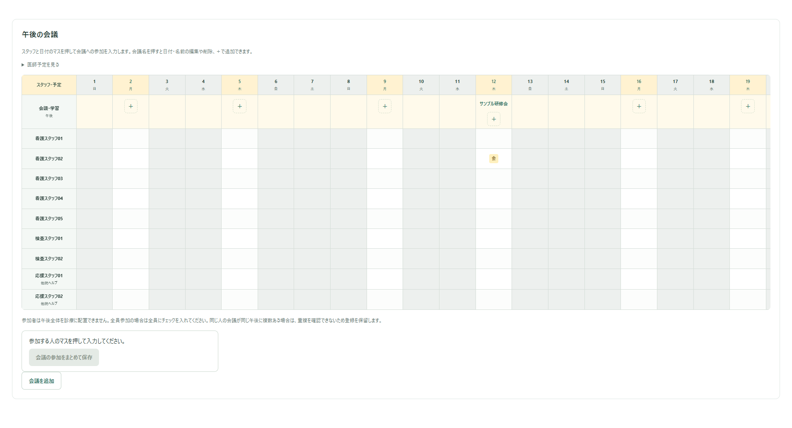

不足の確認

事前ヘルプも使った仮表で、11月9日の午前・午後に検査技師が1人不足する例です。

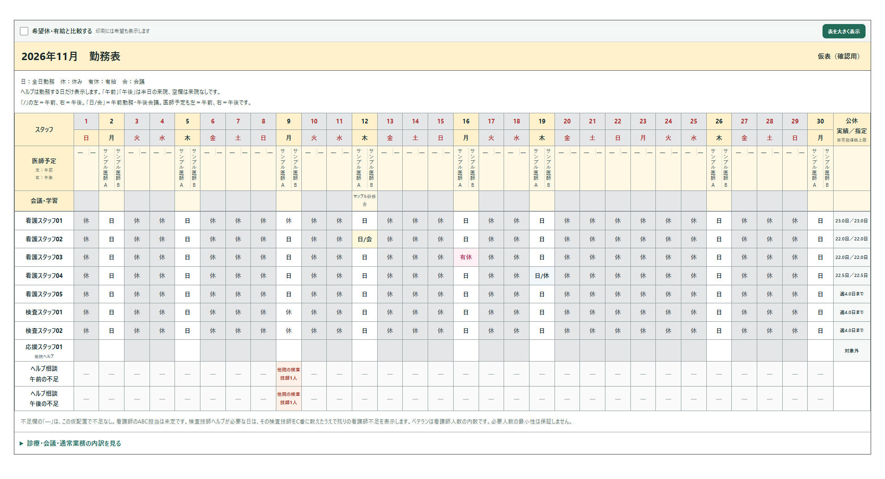

ヘルプの来院登録

不足と来院予定を同じカレンダーで確認します。11月9日の全日来院を選んだ保存前の状態です。

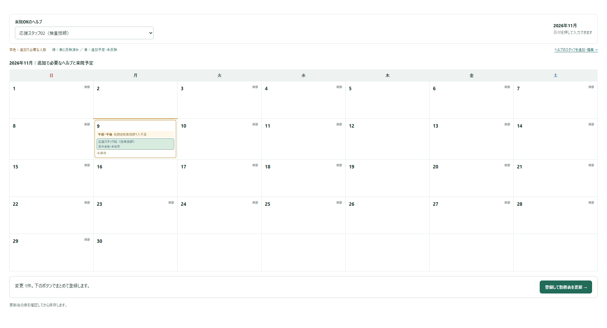

必要人数の設定

医師予定に応じた必要人数と、検査室の人数を確認します。診療日の3日分を表示しています。

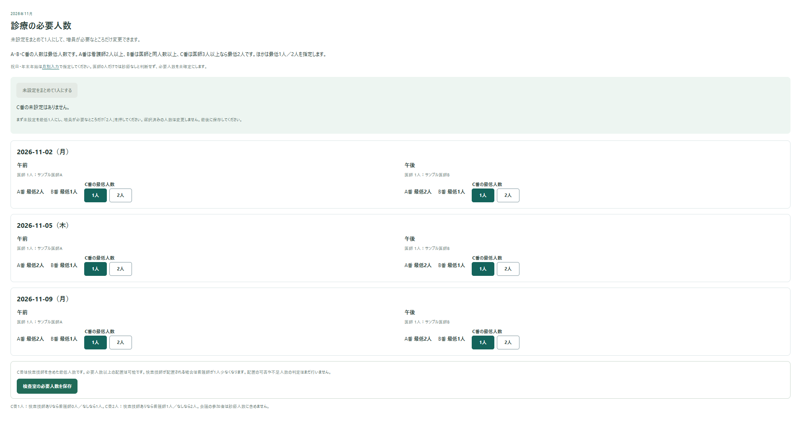

バックアップと復元

全月の入力を保存し、ファイルの内容を確認してから復元する画面です。

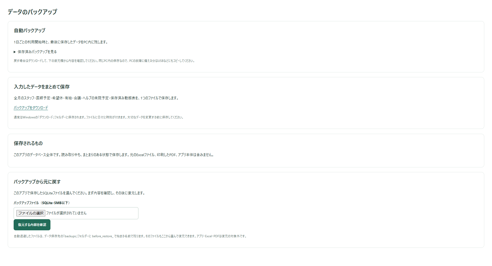

スタッフと担当業務

看護師・検査技師、常勤・非常勤、担当可能な業務を確認できます。

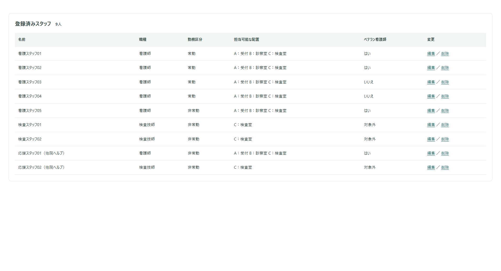

Excelの読み取り確認

Excelから取り出した午前・午後の医師予定を照合する画面です。確認前の候補を表示しています。

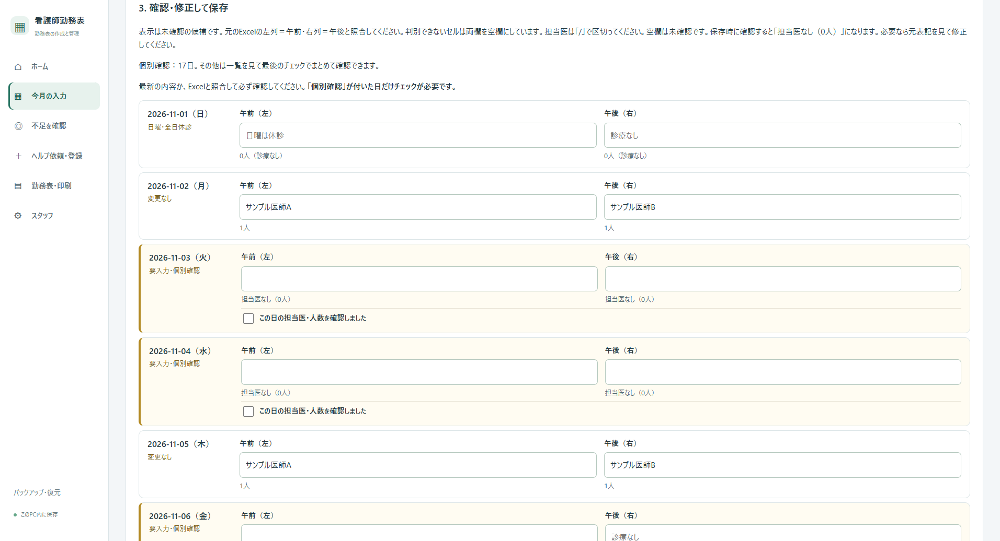

[操作動画と体験版](../README.md) ／ [開発を通じて学んだこと](reflection.md) ／ [聞き取った勤務条件](scheduling-rules.md)
